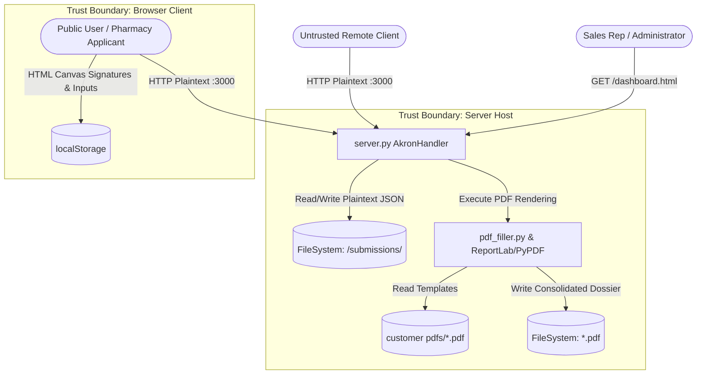

# Security Threat Model: Akron Generics Portal & AIRO Platform

**Assessment Date:** November 5, 2026  
**Target Environment:** `/Users/mukesh/Desktop/airo group`  
**Classification:** Internal Security Architecture Assessment  

---

## 1. System Overview & Architecture Context

The target application comprises a dual-purpose pharmaceutical web ecosystem:
1. **Akron Generics B2B Portal (`html/`, `server.py`, `pdf_filler.py`)**: An online customer onboarding, credit application, and document management platform for licensed pharmacies purchasing wholesale generic pharmaceuticals. It accepts customer identity, regulatory licensure (State Board of Pharmacy, DEA registration), financial data (corporate banking, credit cards), and legal officer signatures, generating a merged 5-page legal PDF dossier.
2. **AIRO Group Prototype (`full/`)**: A multi-brand prototype showcasing clinical patient intake, pharmacy triage queues, doctor review workflows, and condition questionnaires.



---

## 2. Core Assets

| Asset ID | Asset Name | Description & Storage Location | Sensitivity Level | Business / Regulatory Impact |
| :--- | :--- | :--- | :--- | :--- |
| **AST-01** | **Payment Cardholder Data (PCI)** | Full Credit Card Numbers (PAN), CVVs, Expiration Dates stored in `submissions/main_account/*.json` and `localStorage`. | **Critical** | Severe PCI-DSS compliance failure, financial theft, card association fines ($5,000–$100,000/mo). |
| **AST-02** | **Corporate Banking Data (NACHA)** | Bank Account Numbers, Routing Numbers, Account Names, and Voided Check binary images stored in `submissions/` and PDF dossiers. | **Critical** | Unauthorized ACH debits, corporate fraud, NACHA liability. |
| **AST-03** | **Regulatory Licenses & Credentials** | DEA Registration Certificates, State Board of Pharmacy Licenses, Federal Tax IDs (EIN), NPI codes. | **High** | Drug Enforcement Administration (DEA) diversion, illegal diversion of controlled substances, corporate identity theft. |
| **AST-04** | **Legal Signatures** | High-resolution Base64 PNG signatures of Supervising Pharmacists / Officers of the Corporation. | **High** | Fraudulent contract execution, unauthorized wholesale credit commitments. |
| **AST-05** | **Customer PII & Commercial Data** | Owner personal names, cell phone numbers, corporate email addresses, trade reference details, purchase volumes. | **Medium** | Phishing, identity theft, commercial intelligence exposure to competitors. |
| **AST-06** | **Server Filesystem & Source Code** | Python source files (`server.py`, `pdf_filler.py`), templates, runtime process memory. | **High** | System compromise, data exfiltration, lateral movement. |

---

## 3. Trust Boundaries

1. **TB-01: Public Internet / Local Network &rarr; Python HTTP Daemon (`server.py`)**
   - *Boundary:* Any network client sending HTTP requests to TCP port `3000`.
   - *Current Status:* Completely unauthenticated. No TLS/HTTPS encryption, no firewall rule enforced in application logic, no authentication headers evaluated.
2. **TB-02: Server Process &rarr; Local File System (`submissions/`)**
   - *Boundary:* The application process writing JSON files, binary attachments, and rendered PDFs to local disk directories.
   - *Current Status:* Files written using user-supplied parameters (`ref_id`, `sales_mgr`, `fname`) without directory isolation or database access controls.
3. **TB-03: Browser Client &rarr; Local Storage (`localStorage`)**
   - *Boundary:* Web browser security boundary separating origins.
   - *Current Status:* Sensitive financial and PII data placed into unencrypted `localStorage`, readable by any script executing in origin context.

---

## 4. Actors & Threat Profiles

| Actor Profile | Description & Capabilities | Motivation | Access Level |
| :--- | :--- | :--- | :--- |
| **ACT-01: Anonymous External Attacker** | Remote untrusted internet user with network access to port 3000. Capable of automated scripting, port scanning, and API fuzzing. | Financial theft, data extortion, competitive intelligence. | Untrusted / Unauthenticated |
| **ACT-02: Malicious Pharmacy Applicant** | Legitimate or rogue pharmacy applicant filling out the onboarding form. Capable of manipulating JSON payloads, injecting scripts, or uploading weaponized files. | Credit line fraud, uploading backdoors, XSS exploitation against sales reps. | Untrusted Input Provider |
| **ACT-03: Sales Representative / Insider** | Sales agent accessing `dashboard.html`. Expected to view only assigned clients. | Sales poaching, unauthorized customer data browsing. | Semi-trusted Client |
| **ACT-04: Network Eavesdropper / MitM** | Attacker situated on the same Wi-Fi, local area network, or intermediate router. | Wiretapping credentials and banking info in transit. | Network Observer |

---

## 5. Entry Points

- **EP-01:** `GET /api/applications` (`server.py:L33`) &mdash; Returns list of all submitted applications in JSON format.
- **EP-02:** `GET /api/download-official-pdf?id={ref_id}` (`server.py:L52`) &mdash; Streams filled 5–8 page official PDF dossier.
- **EP-03:** `POST /api/submit-application` (`server.py:L100`) &mdash; Accepts full application JSON payload, attachments, and triggers PDF rendering.
- **EP-04:** `POST /api/generate-official-pdf` (`server.py:L84`) &mdash; Accepts arbitrary JSON payload and streams rendered PDF in real time.
- **EP-05:** Static File Server Fallback (`server.py:L98` via `super().do_GET()`) &mdash; Directly serves all files under the project root, including `/submissions/main_account/*.json` and source code.
- **EP-06:** Client-Side DOM & Query Strings &mdash; `dashboard.html` rendering search filters and drawer details; `print-dossier.html?id=` rendering PDF frame.

---

## 6. Threat Analysis (STRIDE Matrix)

### 6.1. Spoofing
- **THR-01: Identity & Representative Spoofing**
  - *Mechanism:* In `POST /api/submit-application`, `salesManager` and `repEmail` are client-supplied strings (`payload.get('salesManager')`). Any applicant or external agent can assign their submission to any representative or fabricate sales managers.
  - *Impact:* Submissions are routed to arbitrary directory structures without verification.

### 6.2. Tampering
- **THR-02: Path Traversal Arbitrary File Overwrite**
  - *Mechanism:* `server.py` line 105 does `main_file = os.path.join(MAIN_ACCOUNT_DIR, f"{ref_id}.json")`. If `ref_id` contains path traversal sequences like `../../some_file`, the server attempts writing outside `MAIN_ACCOUNT_DIR`.
  - *Impact:* Overwrite of existing application records or sensitive operating system files.

### 6.3. Repudiation
- **THR-03: Zero Cryptographic Signature Validation & Untrusted Timestamps**
  - *Mechanism:* `payload['submitted_at'] = time.strftime(...)` is generated locally on server or supplied by client. Digital signatures are raw unverified canvas PNGs with no PKI certificates, time-stamping authority (TSA), or audit trail.
  - *Impact:* Applicants can legally repudiate signing agreements, claiming their signature was spoofed or pasted.

### 6.4. Information Disclosure
- **THR-04: Unauthenticated Mass Exfiltration of Banking, Credit Card & Licensure Records**
  - *Mechanism:* `GET /api/applications` requires zero credentials and returns the full JSON dump of all pharmacies. `GET /api/download-official-pdf?id=...` returns the full legal application packet including CVV and bank account numbers.
  - *Impact:* Complete disclosure of all pharmacy customer data to any network observer or scraper.
- **THR-05: Direct Static Directory Traversal & Exposure of Submissions**
  - *Mechanism:* `SimpleHTTPRequestHandler` serves the entire workspace root. Navigating to `http://localhost:3000/submissions/main_account/` allows directory listing or direct downloading of `.json` records and source files.
  - *Impact:* Direct source code and customer data leakage.

### 6.5. Denial of Service (DoS)
- **THR-06: Resource Exhaustion via Base64 Decompression Bomb**
  - *Mechanism:* `pdf_filler.py` decodes uploaded images in memory via `PIL.Image.open(io.BytesIO(img_bytes))`. Submitting a high-resolution or heavily compressed image payload causes server CPU and memory exhaustion.
  - *Impact:* Single-threaded server blocks entirely; service becomes unresponsive.

### 6.6. Elevation of Privilege
- **THR-07: Unrestricted Access to Representative & Admin Portals**
  - *Mechanism:* `dashboard.html` has no login wall, session verification, or role-based access control. Any external user navigating to `/html/dashboard.html` is granted full administrative visibility.
  - *Impact:* Unauthorized access to administrative operations and confidential records.

---

## 7. Concrete Attack Scenarios

### Scenario A: Unauthenticated Full Customer Database & Banking Exfiltration
1. **Reconnaissance:** Attacker scans port 3000 and observes HTTP server running `SimpleHTTP/0.6 Python/3.13`.
2. **Exploitation:** Attacker issues `GET http://localhost:3000/api/applications`.
3. **Execution:** The server reads all `.json` files in `submissions/main_account/` and returns an array containing pharmacy names, federal tax IDs, credit card numbers, CVVs, bank account numbers, and routing numbers.
4. **Follow-up:** Attacker calls `/api/download-official-pdf?id={ref_id}` for each entry, obtaining official 8-page signed legal agreements and voided checks.

### Scenario B: Cross-Site Scripting (XSS) via Applicant Input Leading to Credential Exfiltration
1. **Injection:** Attacker submits a fraudulent pharmacy application via `POST /api/submit-application` with `legalBusinessName` set to:
   ```html
   
   ```
2. **Trigger:** A sales representative opens `html/dashboard.html` to review new leads.
3. **Execution:** In `dashboard.html:L811`, the dashboard constructs HTML table rows via string concatenation:
   ```javascript
   '<td><strong>' + (app.businessName || '--') + '</strong>...'
   ```
   The script executes in the representative's browser context, exfiltrating the entire `localStorage` contents to the attacker.

---

## 8. Risk Assessment Matrix

| Threat ID | Threat Description | Likelihood | Impact | Overall Severity |
| :--- | :--- | :--- | :--- | :--- |
| **THR-04** | Unauthenticated mass customer financial & PII exfiltration | **High** | **Critical** | **CRITICAL** |
| **THR-01** | Lack of authentication/authorization on portal APIs | **High** | **Critical** | **CRITICAL** |
| **THR-02** | Path traversal in file storage via unsanitized `ref_id` | **Medium** | **High** | **HIGH** |
| **THR-05** | Public static file serving of sensitive backend folders | **High** | **High** | **HIGH** |
| **THR-06** | Single-threaded PDF compilation Denial of Service | **Medium** | **Medium** | **MEDIUM** |
| **THR-07** | Stored XSS via unsanitized application inputs in dashboard | **Medium** | **High** | **HIGH** |
| **THR-08** | In-transit eavesdropping due to plaintext HTTP/1.0 | **High** | **High** | **HIGH** |

---

## 9. Existing vs. Missing Mitigations

### Existing Controls (Verified in Codebase):
- [x] Basic filename sanitization (`sanitize_name` in `server.py:L19`) for sales manager directory names and attachment suffixes.
- [x] Client-side canvas clearing and signature capture.
- [x] Segregated representative storage structure (`submissions/by_representative/<rep>/`).

### Missing Controls (Deficits Verified in Codebase):
- [ ] **No Authentication/Session Management**: Endpoints `/api/applications`, `/api/submit-application`, `/api/download-official-pdf` have zero auth controls.
- [ ] **No Transport Security (TLS/HTTPS)**: Plaintext HTTP only.
- [ ] **No Storage Encryption**: PCI PAN, CVVs, and bank account numbers are stored in plain JSON files on disk.
- [ ] **No Input Validation / Sanitization**: `ref_id`, `legalBusinessName`, etc., are not validated against schemas or encoded prior to DOM insertion.
- [ ] **No Rate Limiting / Abuse Protection**: Endpoints accept unlimited requests without throttling.
- [ ] **No Secure CORS Configuration**: `Access-Control-Allow-Origin: *` allows any origin to query the APIs.
- [ ] **No Safe File Storage Architecture**: Uploaded attachments and JSON databases sit inside the publicly servable root directory.
