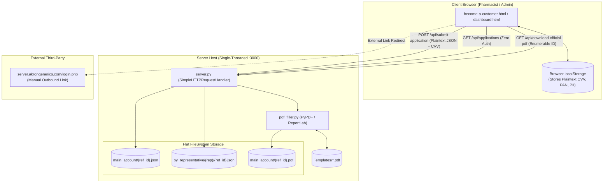
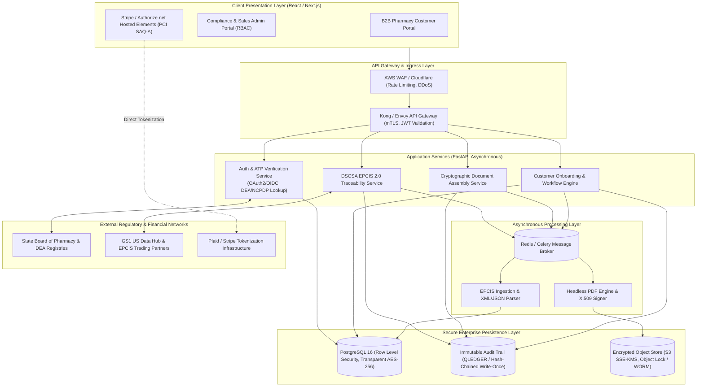

# Architectural Audit & System Design Review: Akron Generics Platform

**Author:** ECC Architect Specialist Agent  
**Target:** Akron Generics Wholesale Platform, Document Processing Engine, and DSCSA T3 Architecture  
**Date:** November 2026  

---

## Executive Summary & Scorecard

We have completed an architectural audit and system design evaluation of the **Akron Generics** platform.

While the frontend exhibits high aesthetic quality and clear onboarding forms, the underlying system architecture exhibits **critical architectural, scalability, security, and regulatory compliance gaps**:

| Architectural Domain | Rating | Primary Architectural Risk / Bottleneck |
| :--- | :---: | :--- |
| **Concurrency & Scalability** | **1.5 / 10** | Single-threaded synchronous HTTP server (`socketserver.TCPServer`). Heavy CPU-bound PDF rendering blocks all incoming requests. |
| **Data Architecture** | **2.0 / 10** | No database. Unindexed flat-file JSON storage with O(N) disk scans; enumerable 4-digit predictable account keys (`AKR-YYYY-####`). |
| **API & Access Security** | **1.0 / 10** | Zero authentication or authorization on all endpoints (`/api/applications`) and admin screens; wildcard CORS (`*`). |
| **PCI-DSS v4.0 Compliance** | **0.0 / 10** | **CRITICAL VIOLATION:** Plaintext storage of Card Verification Values (CVV) and Primary Account Numbers (PAN) in server files and `localStorage`. |
| **FDA 21 CFR Part 11** | **1.5 / 10** | Unsecured canvas signature drawings without cryptographic binding, signer authentication, or tamper-evident audit trails. |
| **DSCSA T3 / EPCIS 2.0** | **2.0 / 10** | Informational only. No internal serialized inventory or EPCIS data exchange; redirects to an unintegrated legacy PHP login. |
| **Frontend Modularity** | **4.0 / 10** | Dual-tree codebase duplication; modern Redux/hooks/services modules exist in `src/` but are completely orphaned and unused. |

---

## 1. Current State Codebase & Component Analysis

### 1.1. Codebase Structure & Architectural Disconnect
- **Dual-Tree Duplication:** The frontend maintains root-level HTML files (`index.html`, `become-a-customer.html`, `dashboard.html`, `my-t3.html`) alongside copies in `frontend/src/pages/`.
- **Orphaned Modular Layer:** Inside `frontend/src/`, an embryonic modern JavaScript framework was scaffolded (Redux in `redux/store.js` & `applicationSlice.js`, custom hooks in `hooks/useSignature.js`, API clients in `services/api.js`). However, **none of the active HTML pages import or use these modules**. Instead, pages rely on massive inline `<script>` tags, global functions, and direct `localStorage` manipulation.
- **Route Mismatch:** `frontend/src/services/api.js` targets `POST /api/become-a-customer`, while `backend/server.py` strictly listens on `POST /api/submit-application`.

### 1.2. Backend Analysis (`backend/server.py`)
- **Single-Threaded Blocking I/O:** Runs on Python’s standard library `socketserver.TCPServer(("", PORT), AkronHandler)` without `ThreadingMixIn`. A single customer submission generating a PDF blocks all other concurrent network requests for 1.5–4 seconds.
- **Unrestricted CORS & Public API:** Wildcard `Access-Control-Allow-Origin: *` is returned on all responses. `GET /api/applications` has no authentication, allowing any external internet client to execute a full customer database dump.
- **Predictable & Enumerable IDs:** Reference IDs are generated as `AKR-YYYY-####` using `int(time.time() % 10000)`. A 4-digit space allows complete enumeration of all customer records within minutes.

### 1.3. PDF Generation Engine (`backend/pdf_filler.py`)
- **Synchronous CPU Saturation:** Ingests 5 AcroForm PDF templates, renders ReportLab overlays, decodes base64-encoded file attachments (DEA licenses, voided checks), and stitches them into a consolidated dossier on the main execution thread.
- **Rigid Coordinate Hardcoding:** Digital signatures rely on brittle 72-dpi point coordinates (`SIG_BOXES = {'credit_app': (88.0, 63.0, 140.0, 22.0), ...}`). Any legal template layout adjustment silently misaligns signatures.
- **No Digital Sealing:** The generated PDF is unencrypted and lacks an X.509 digital signature digest. Alterations post-issuance cannot be detected.

---

## 2. Component Architecture & Data Flows

### 2.1. Current System Topology & Flow

---

## 3. System Design, Scalability & Regulatory Compliance Audit

### 3.1. Scalability & Operational Bottlenecks
1. **Concurrency Lockout:** Synchronous execution means any concurrent request hitting the server while `pdf_filler.py` processes a 10MB license scan times out or experiences massive latency spikes.
2. **O(N) Unindexed File Reads:** `GET /api/applications` loops through `os.listdir(MAIN_ACCOUNT_DIR)`, parsing every individual JSON file on disk. Disk I/O degrades rapidly once account volume surpasses a few hundred submissions.
3. **Container Impossibility:** Because state and files are written to local disk paths (`backend/data/submissions/`), the application cannot scale horizontally behind a load balancer without data partitioning breakage.

### 3.2. Regulatory Compliance Deficiencies
1. **PCI-DSS v4.0 (Requirement 3.2.2 & 3.4):**
   - **Severe Non-Compliance:** Storing Card Verification Values (CVV/CVC) after transaction authorization is explicitly prohibited. The application currently records `"cardCvv"` in server JSON files and browser `localStorage`.
   - **Remediation:** Remove all CVV storage immediately and implement hosted tokenization (Stripe Elements / Authorize.net Accept.js).
2. **NACHA Operating Rules:**
   - Plaintext banking routing and account numbers are stored unencrypted on disk and exposed via unauthenticated API responses.
   - **Remediation:** Implement Plaid Auth or encrypted token vaults; mask bank details in administrative views.
3. **FDA 21 CFR Part 11 (Electronic Records & Signatures):**
   - **§ 11.10(e) Audit Trails:** Absence of immutable, time-stamped audit logs.
   - **§ 11.50 Signature Manifestations:** Electronic signatures lack printed signer name, UTC timestamp, and legal meaning.
   - **§ 11.70 Signature Linking:** Canvas drawings are merely visual image stamps with no cryptographic binding to the PDF payload.
   - **§ 11.200 Identification Components:** No two-factor authentication or verified identity backing the signature.
4. **DSCSA 2024 Final Interoperability Mandates:**
   - Requires electronic, package-level tracing using **GS1 EPCIS 1.2 / 2.0**.
   - Requires Authorized Trading Partner (ATP) validation against state licensing authorities.
   - Requires 6-year secure electronic data archiving with rapid 24–48 hour regulatory retrieval. The current platform has no internal EPCIS capability.

---

## 4. Target Architecture & System Design Proposal

### 4.1. Modernized Microservices / Modular Blueprint

---

## 5. Architecture Decision Records (ADRs)

### ADR-001: Modernization of Backend Architecture & Asynchronous Job Processing
- **Decision:** Migrate `backend/server.py` to **Python FastAPI** with **Uvicorn/Gunicorn**. Decouple PDF generation and heavy file operations into asynchronous background workers using **Celery** with **Redis**.
- **Rationale:** Resolves single-threaded blocking bottlenecks, introduces strict Pydantic request validation, and enables horizontal containerization on AWS ECS / Kubernetes.

### ADR-002: GS1 EPCIS 2.0 Interoperable DSCSA Traceability Data Exchange
- **Decision:** Build an internal **DSCSA EPCIS 2.0 Ingestion and Query Service**. Ingest EPCIS XML/JSON-LD files via secure AS2 and HTTPS. Store raw events in **AWS S3 Object Lock (WORM)** for 6-year regulatory retention, indexing serialized package data in PostgreSQL for instant self-service lookup in `my-t3.html`.
- **Rationale:** Delivers full compliance with federal 2024+ DSCSA mandates and enables automated 24-hour turnaround for FDA suspect product investigations.

### ADR-003: Remediation of PCI-DSS & NACHA Financial Secrets Storage
- **Decision:** Immediately eliminate all storage of CVVs and unencrypted PANs. Implement **Stripe Elements** (or Authorize.net Accept.js) for credit card tokenization, and **Plaid Auth** for bank account verification. Purge all legacy JSON submission files containing cardholder data.
- **Rationale:** Achieves PCI-DSS **SAQ-A** eligibility (lowest compliance burden), protects customer financial data, and eliminates card network penalty liabilities.

### ADR-004: FDA 21 CFR Part 11 Compliant Electronic Signatures & WORM Audit Trail
- **Decision:** Upgrade electronic signatures to require 2FA identity validation (portal credentials + SMS OTP), render complete signature manifestations (Signer Name, UTC Date/Time, Meaning), cryptographically seal output PDFs with an **X.509 digital certificate**, and maintain an immutable hash-chained audit ledger.
- **Rationale:** Guarantees legal non-repudiation of wholesale contracts and ensures full inspection readiness for FDA and State Board audits.

---

## 6. Phased Implementation Roadmap

```mermaid
flowchart LR
    subgraph Phase1 ["Phase 1: Critical Security Remediation (Weeks 1-3)"]
        P1_1["Eliminate CVV & PAN Storage"]
        P1_2["Secure Endpoints with JWT Auth"]
        P1_3["Sanitize & Purge Legacy Submissions"]
    end

    subgraph Phase2 ["Phase 2: Platform Modernization (Weeks 4-7)"]
        P2_1["FastAPI Migration & PostgreSQL DDL"]
        P2_2["Celery/Redis Asynchronous PDF Engine"]
        P2_3["21 CFR Part 11 Digital Signatures"]
    end

    subgraph Phase3 ["Phase 3: DSCSA EPCIS 2.0 Integration (Weeks 8-12)"]
        P3_1["EPCIS 2.0 Ingestion & S3 WORM Archive"]
        P3_2["Automated ATP Licensure Verification"]
        P3_3["Self-Service Customer My T3 Portal"]
    end

    Phase1 --> Phase2 --> Phase3
```

### Actionable Next Steps (Immediate Hotfixes)
1. **Strip CVV Capture:** Remove the CVV input fields from `become-a-customer.html` and eliminate `'CVV'` mapping in `pdf_filler.py`.
2. **Restrict CORS & Socket Binding:** Remove `Access-Control-Allow-Origin: *` in `server.py` and bind socket server to `127.0.0.1` rather than `0.0.0.0`.
3. **Enforce Endpoint Authentication:** Add basic authentication/token checks to `/api/applications` and `/api/download-official-pdf` to block public data scraping.

